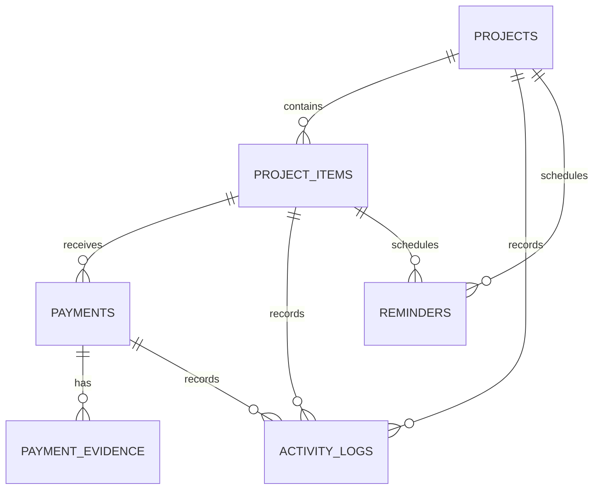

# DATABASE.md — Local Data Model

## 1. Database principles

- SQLite is the initial source of truth.
- Use versioned migrations.
- Enable and verify SQLite foreign-key enforcement.
- Store timestamps in UTC ISO-8601 or integer epoch consistently; convert to local time for display.
- Store monetary amounts as integer minor units. For KES, document whether fractional amounts are supported; default to integer KES if the product explicitly disallows fractions.
- Store ISO 4217 currency code on every financial entity.
- Keep binary evidence files in app-private filesystem storage; store metadata and relative paths in SQLite.
- Never silently cascade-delete payment/evidence history.
- Use transactions for multi-table writes.
- Add indexes for foreign keys and common date/status lookups.

## 2. Entity relationship overview

## 3. Tables

### projects

| Column | Type | Rules |
|---|---|---|
| id | TEXT | PK; UUID |
| name | TEXT | NOT NULL |
| description | TEXT | nullable |
| start_date | TEXT | nullable ISO date |
| target_end_date | TEXT | nullable ISO date |
| status | TEXT | NOT NULL; active/on_hold/completed/archived |
| currency_code | TEXT | NOT NULL; default KES |
| created_at | TEXT | NOT NULL |
| updated_at | TEXT | NOT NULL |
| archived_at | TEXT | nullable |

Indexes: `status`, `target_end_date`.

### project_items

| Column | Type | Rules |
|---|---|---|
| id | TEXT | PK; UUID |
| project_id | TEXT | FK projects.id, NOT NULL, ON DELETE RESTRICT |
| title | TEXT | NOT NULL |
| description | TEXT | nullable |
| due_at | TEXT | nullable |
| expected_amount_minor | INTEGER | nullable; >= 0 |
| currency_code | TEXT | NOT NULL |
| completion_status | TEXT | NOT NULL; open/in_progress/completed/cancelled |
| priority | TEXT | nullable; low/normal/high/urgent |
| completed_at | TEXT | nullable |
| created_at | TEXT | NOT NULL |
| updated_at | TEXT | NOT NULL |
| archived_at | TEXT | nullable |

Indexes: `(project_id, due_at)`, `(project_id, completion_status)`, `due_at`.

### payments

| Column | Type | Rules |
|---|---|---|
| id | TEXT | PK; UUID |
| project_item_id | TEXT | FK project_items.id, NOT NULL, ON DELETE RESTRICT |
| amount_minor | INTEGER | NOT NULL; > 0 |
| currency_code | TEXT | NOT NULL |
| paid_at | TEXT | NOT NULL |
| method | TEXT | NOT NULL; mpesa/cash/bank/card/other |
| transaction_reference | TEXT | nullable |
| raw_confirmation_text | TEXT | nullable |
| notes | TEXT | nullable |
| record_status | TEXT | NOT NULL; recorded/voided |
| created_at | TEXT | NOT NULL |
| updated_at | TEXT | NOT NULL |
| voided_at | TEXT | nullable |
| void_reason | TEXT | nullable |

Indexes: `(project_item_id, paid_at)`, `transaction_reference`, `record_status`.

Do not hard-delete a payment in normal UI flows. Void it with a reason and activity log.

### payment_evidence

| Column | Type | Rules |
|---|---|---|
| id | TEXT | PK; UUID |
| payment_id | TEXT | FK payments.id, NOT NULL, ON DELETE RESTRICT |
| evidence_type | TEXT | NOT NULL; pasted_text/image/pdf/document/other |
| original_filename | TEXT | nullable |
| relative_path | TEXT | nullable; required for file evidence |
| mime_type | TEXT | nullable |
| byte_size | INTEGER | nullable |
| checksum_sha256 | TEXT | nullable |
| pasted_text | TEXT | nullable |
| created_at | TEXT | NOT NULL |

Indexes: `payment_id`.

Pasted M-Pesa text may be stored in `payments.raw_confirmation_text` for the main confirmation and/or as a `payment_evidence` text record when multiple pieces of evidence are needed. Avoid accidental duplication in UI.

### activity_logs

| Column | Type | Rules |
|---|---|---|
| id | TEXT | PK; UUID |
| project_id | TEXT | FK projects.id, nullable, ON DELETE RESTRICT |
| project_item_id | TEXT | FK project_items.id, nullable, ON DELETE RESTRICT |
| payment_id | TEXT | FK payments.id, nullable, ON DELETE RESTRICT |
| event_type | TEXT | NOT NULL |
| summary | TEXT | NOT NULL |
| details_json | TEXT | nullable; versioned structured details |
| created_at | TEXT | NOT NULL |

Indexes: `(project_id, created_at)`, `(project_item_id, created_at)`, `(payment_id, created_at)`.

Activity examples: project_created, item_created, item_updated, item_completed, item_reopened, payment_recorded, payment_updated, payment_voided, evidence_added, reminder_changed.

### reminders

| Column | Type | Rules |
|---|---|---|
| id | TEXT | PK; UUID |
| project_id | TEXT | FK projects.id, nullable, ON DELETE RESTRICT |
| project_item_id | TEXT | FK project_items.id, nullable, ON DELETE RESTRICT |
| reminder_type | TEXT | NOT NULL; deadline/payment/custom |
| scheduled_at | TEXT | NOT NULL |
| advance_minutes | INTEGER | nullable; >= 0 |
| enabled | INTEGER | NOT NULL; 0/1 |
| notification_identifier | TEXT | nullable; OS scheduling identifier |
| last_scheduled_at | TEXT | nullable |
| created_at | TEXT | NOT NULL |
| updated_at | TEXT | NOT NULL |

Require at least one of `project_id` or `project_item_id`; validate that the referenced item belongs to the referenced project if both are supplied. Index `(enabled, scheduled_at)`, `project_item_id`.

### settings

| Column | Type | Rules |
|---|---|---|
| key | TEXT | PK |
| value_json | TEXT | NOT NULL |
| updated_at | TEXT | NOT NULL |

Use for non-secret preferences only (default currency, lock timeout, reminder preferences, onboarding completion). Secrets and PIN verifier material belong in secure storage, not this table.

## 4. Derived values and business rules

For a project item:
- `amount_paid_minor` = sum of `payments.amount_minor` where `record_status = 'recorded'` and currency matches item currency.
- `balance_minor` = expected amount minus amount paid; display outstanding as `max(0, balance_minor)`.
- If amount paid exceeds expected amount, show overpaid amount separately.
- If expected amount is null, payment state is `not_applicable` until an expected amount is set; payment records may still be retained if business rules allow, but UI must make this explicit.
- `payment_status`: unpaid, partially_paid, paid, overpaid, not_applicable.
- `completion_status` is independent and never inferred from payment status.

Project financial totals must not silently combine currencies. Calculate totals from active/non-archived items according to a documented policy. Do not count cancelled items in planned spend unless the product explicitly chooses to show them separately.

Project progress = completed eligible items / total eligible items. Exclude cancelled and archived items from denominator; show an empty/undefined state if no eligible items exist.

## 5. Delete, archive and retention policy

- Project deletion should be blocked when it has financial records unless an explicit export-and-delete flow is approved.
- Prefer archive for projects and items.
- Payments are voided, not silently deleted.
- Evidence cannot be deleted while leaving a payment falsely appearing fully evidenced; require explicit confirmation and log the action.
- Foreign-key rules must protect financial history.

## 6. Migrations and validation

- Every schema change requires a numbered migration.
- Test fresh database creation and upgrade from every supported prior schema version.
- Use SQLite transactions for payment + evidence + activity log writes.
- Validate currency consistency between item and payment unless explicit multi-currency-per-item behaviour is designed.
- Test duplicate transaction references as warnings, not automatic rejection, because legitimate edge cases may exist.
- Test amount boundaries, overpayments, partial payments, voiding and rounding.
- Test missing attachment files and failed imports.

## Amendments (v1 decisions)
- projects: ADD `color_key TEXT NOT NULL DEFAULT 'coral'` (one of the palette keys in design.json).
- project_items: ADD `avatar_key TEXT NOT NULL` (key from avatars.json; default picked at random when creating).
  REPLACE `due_at` with `due_date TEXT` (YYYY-MM-DD, floating local) and `due_time TEXT` (HH:mm, nullable).
  Indexes: (project_id, due_date), due_date, (completion_status, due_date).
  `priority` stays in the schema, default 'normal', not shown in v1 UI.
- payments: `transaction_reference` and `counterparty` stay nullable and unused by the v1 UI (reserved for a future parser).
  `raw_confirmation_text` holds the pasted message verbatim.
  Duplicate check: warn when another recorded payment has identical text after trimming and collapsing whitespace. Never block.
- payment_evidence: v1 stores images/pdf/files only. Do not create `pasted_text` evidence rows.
- reminders: `project_item_id` NOT NULL; no project-level reminders in v1. `scheduled_at` stays UTC.
- Money: minor units (1/100), including KES. UI hides ".00".
- settings: remove any PIN-related keys. Keep lockTimeout, weekStart, defaultReminder.
- Derived values (paid, balance, status, progress) are computed in `src/db/derived.ts`, not stored.
- Startup check: foreign_keys=ON, `PRAGMA integrity_check`, schema version = latest.